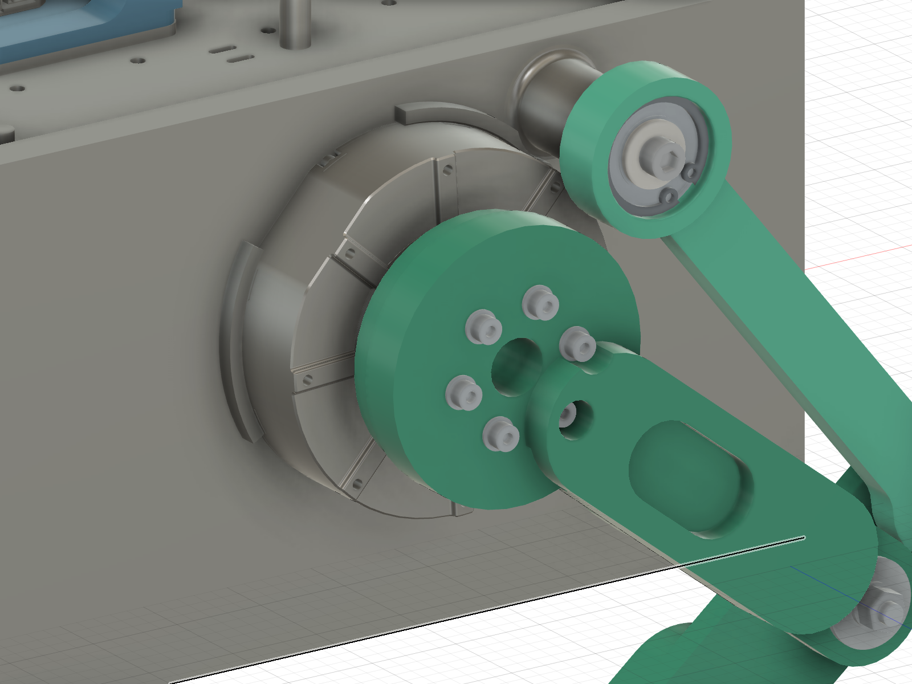

# V20 结构模型

归档版本：V20，髋根一体直装；归档日期：2026-11-18。

| 文件 | 用途 |
| --- | --- |
| `rk-cameraman_V20_整机装配.step.gz` | 通用整机装配模型的无损压缩文件，解压后为 STEP，单位 mm |
| `左_一体大腿.step`、`右_一体大腿.step` | 左右一体大腿及直装根部模型 |
| `髋部一体根部.png` | 髋部结构预览 |
| `SHA256SUMS.txt` | 文件完整性校验 |

整机 STEP 原文件超过 GitHub 普通 Git 的单文件限制，因此上传压缩版；本地保留原始 STEP。macOS 可双击 `.gz` 解压，或在本目录运行 `gzip -dk rk-cameraman_V20_整机装配.step.gz`。解压结果与 V20 原始 STEP 完全一致。

V20 采用一体大腿根部直接连接髋电机输出盘，取消原短法兰与金属压环。已有记录检查了 30°、45°、60° 姿态下的根部干涉与工具可达性；电机 M4 螺钉允许旋入深度、打印件强度及耐久、全行程连续扫掠仍待实物或进一步分析确认。

对应打印文件见 [V20-R1](../../3D打印/V20-R1/)。R1 仅修订打印副本的 B085、B103、B104，整机 CAD 保留 V20 原归档状态。
